# Money Tracker System - Architecture Diagrams

## 1. High-Level System Architecture

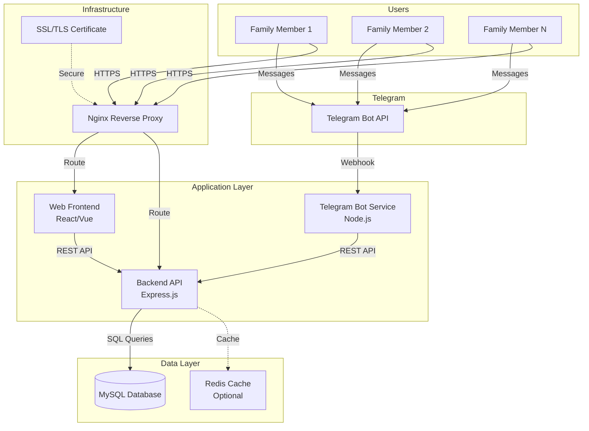

## 2. Data Flow - Transaction Creation via Telegram

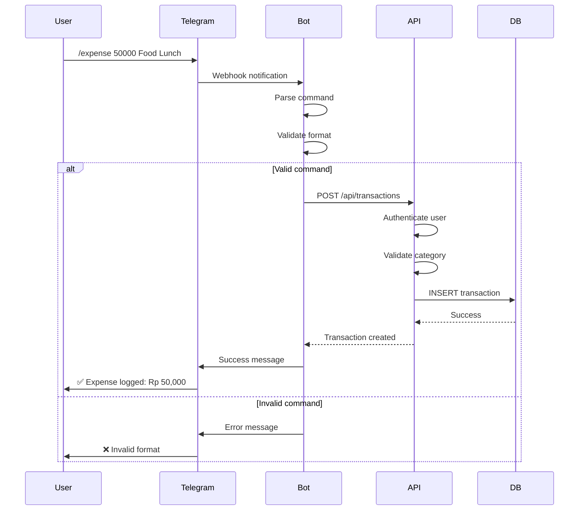

## 3. Data Flow - Web Dashboard Access

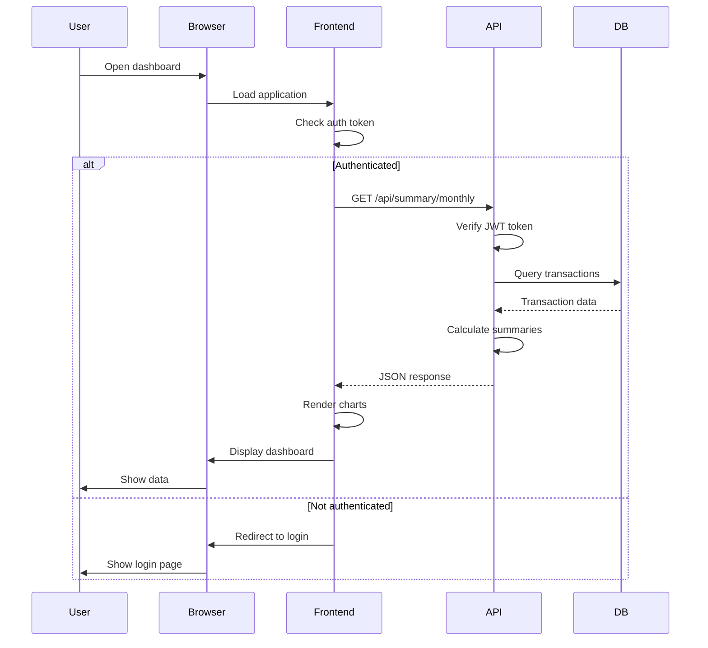

## 4. Database Entity Relationship Diagram

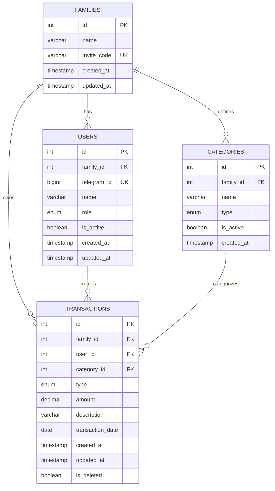

## 5. Component Architecture

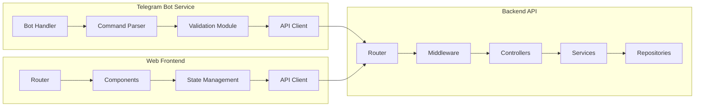

## 6. Deployment Architecture

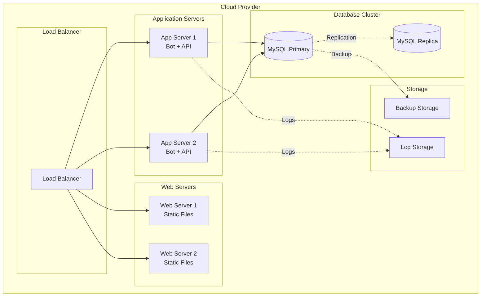

## 7. User Authentication Flow

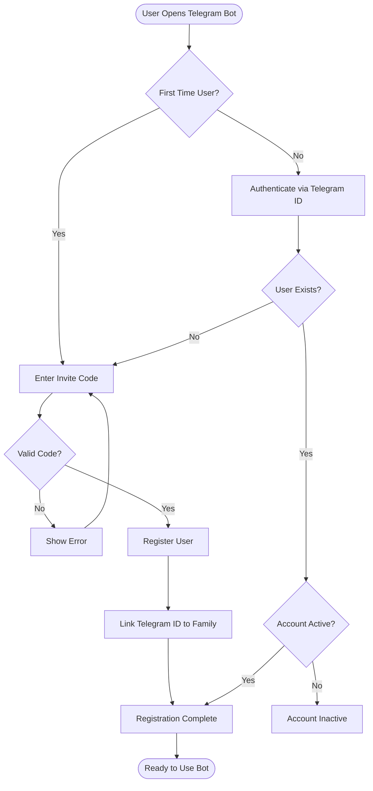

## 8. Transaction Processing Flow

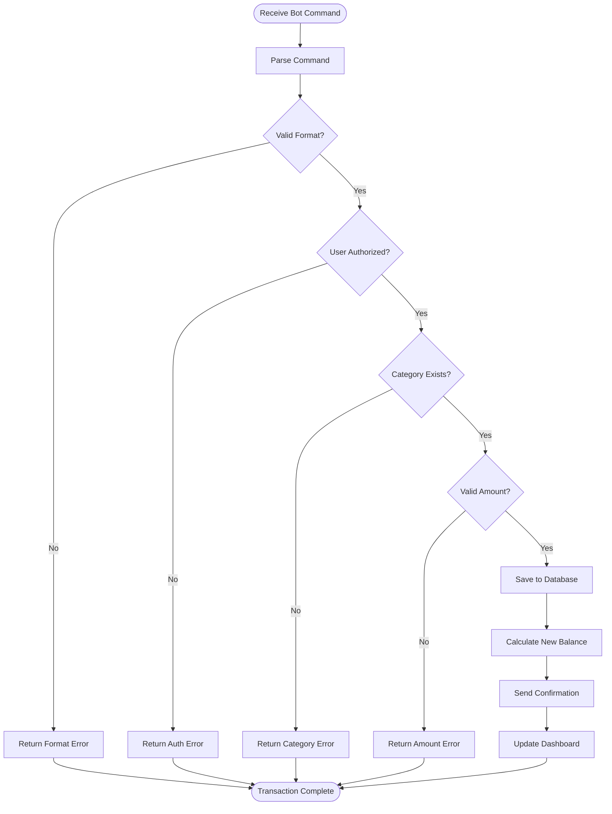

## 9. Monthly Summary Generation

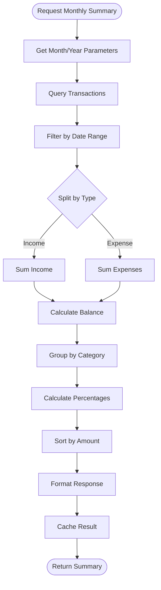

## 10. Security Layers

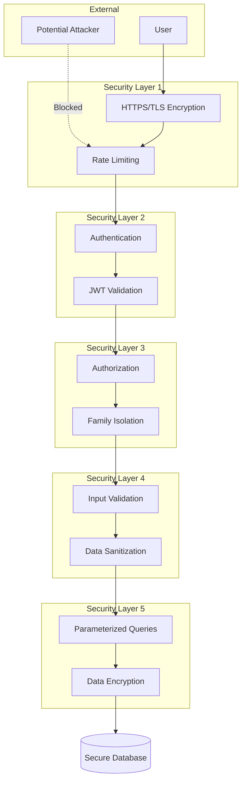

## 11. API Request Flow

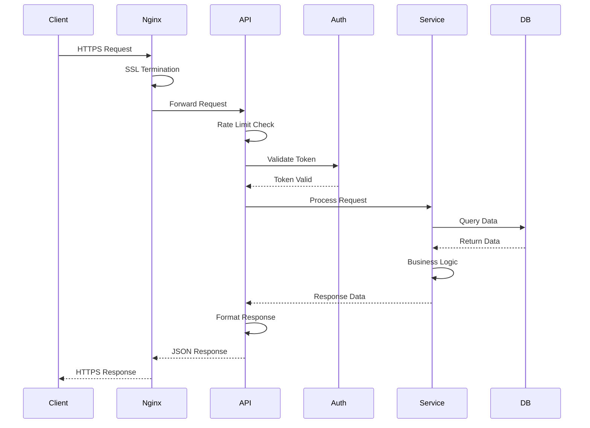

## 12. Backup and Recovery Strategy

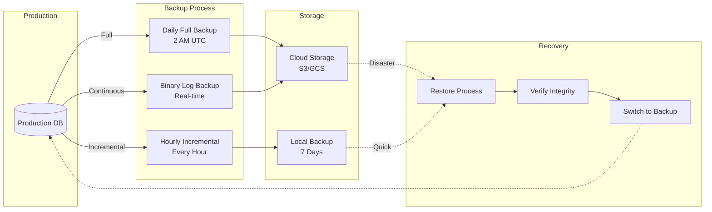

---

## Architecture Notes

### Scalability Considerations
- **Horizontal Scaling**: Add more application servers behind load balancer
- **Database Scaling**: Implement read replicas for query distribution
- **Caching**: Add Redis for frequently accessed data
- **CDN**: Use CDN for static web assets

### High Availability
- **Multi-AZ Deployment**: Deploy across multiple availability zones
- **Database Replication**: Primary-replica setup with automatic failover
- **Health Checks**: Continuous monitoring with automatic recovery
- **Backup Strategy**: Multiple backup tiers with tested recovery procedures

### Performance Optimization
- **Database Indexing**: Strategic indexes on frequently queried columns
- **Query Optimization**: Efficient SQL queries with proper joins
- **API Caching**: Cache frequently requested summaries
- **Connection Pooling**: Reuse database connections

### Monitoring and Observability
- **Application Logs**: Structured logging with log aggregation
- **Metrics**: Track response times, error rates, throughput
- **Alerts**: Automated alerts for critical issues
- **Dashboards**: Real-time system health dashboards